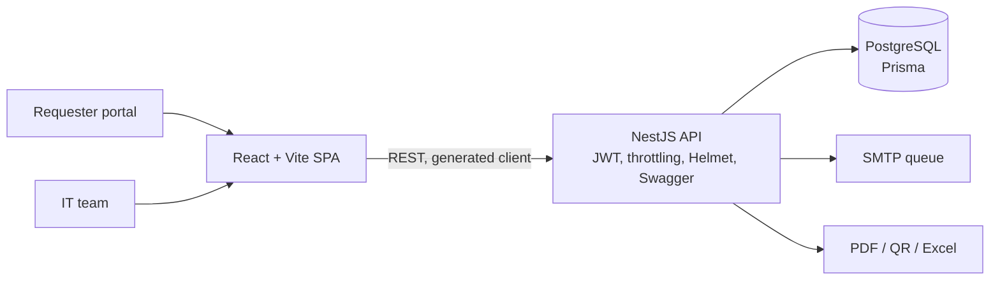

# IT Asset Management & Help Desk System: Case Study

> Internal IT system for **Vale Verde Festas** with two modules in one app: **equipment lifecycle** and **help desk tickets with SLA**.
> **Source code is private.** This repository documents the project; a live walkthrough is available on request.

## The problem

Laptops, phones and accessories were handed out with no record of who had what, in what condition, or when they had last been checked. IT requests arrived over WhatsApp with no priority, no SLA and no history.

## Module 1: Equipment

- Employees, areas, equipment types and accessories; **automatic asset tags** (`EQP-YEAR-NNNN`).
- **Hand-over and return** with accessories checklist and initial condition, **responsibility term in PDF** with digital acceptance, and a full **timeline** per device.
- **Periodic inspections** scheduled automatically (random 50–70 business days, skipping weekends and holidays), a **state machine** (scheduled → notified → done / no-show → rescheduled / overdue), hourly job with 72-hour notices, **mobile-first inspection screen** and **QR codes** with A4 label sheets.
- **Damage and maintenance** lifecycle with costs, **linear depreciation** and a **dashboard** with KPIs and charts.
- **Excel importer** with row-by-row validation and **global search** (PostgreSQL `pg_trgm`, Ctrl+K).

## Module 2: Help desk

- **Lightweight requester login** (first access and password reset by email) and a **"My tickets" portal**.
- **Calculated priority**, **SLA in business hours**, protocol numbers and **automatic assignment**.
- IT operations panel with filters and counters, append-only status log, internal vs. public notes, **macros**, tags, **time tracking**, reassignment.
- **Systems registry** with change log and a **public status page**, **knowledge base** (public/internal) and a **recurrence detector** by device, system or category.
- Email notification queue (SMTP with retry) and **event-level audit log** for every change.

## Architecture

- pnpm monorepo, TypeScript strict, OpenAPI contract with a generated client (Orval), Zod validation.
- ~86k lines of TypeScript, 45+ test files.

## My role

I specified the system (the IT management guide it implements) and rebuilt it end to end on top of an initial prototype: architecture, full stack development, standards and roadmap.

---
Built by **Victor Sestrem** · [LinkedIn](https://www.linkedin.com/in/victor-sestrem/) · victor-sestrem@hotmail.com
